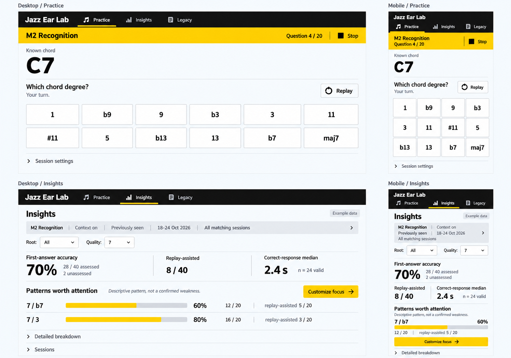
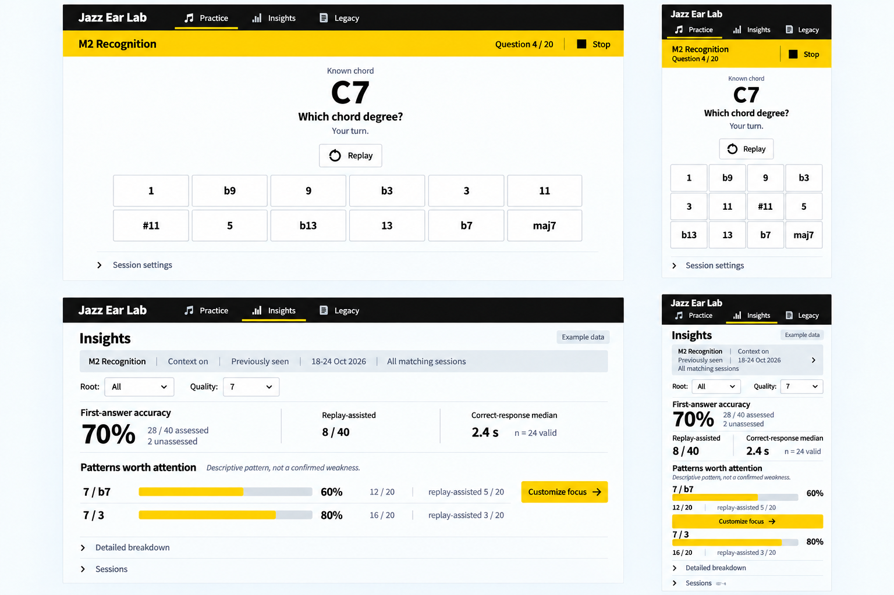
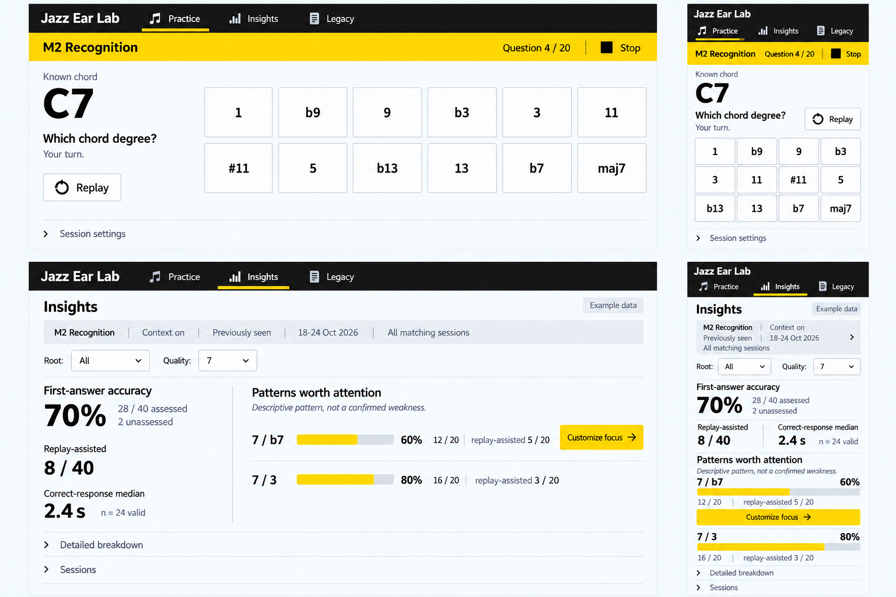

# Signal Route Composition Comparison

Status: Awaiting user composition approval, 2026-10-24. The visual identity is selected; no application implementation has started. The comp-led workflow is in its comps phase, not its code phase. The user requested continuation of visual exploration, not application edits.

## Fixed Constraints

All three options use Signal Route: black navigation, yellow current-task/action bands, humanist sans, white workspaces, quiet rules and flat rectangular controls. The V2 scope, Jazz Ear Lab naming, unchanged Legacy, approved UX principles and existing exercise/analytics semantics remain fixed. This round changes composition, not brand direction or available functionality.

Each board compares the same ready-state M2 question and illustrative Insights evidence on desktop and phone. Example data is not the user's performance. M2 uses known C7, 12 unselected canonical answers, first-response readiness, Replay and Stop; no pre-answer Reveal or Next. Insights uses scope -> accuracy -> supported patterns and practice action -> details, with identical numerators, denominators and caution text. Filters remain Root and Quality, not invented date/mode controls.

## Options and Tradeoffs

| Option | Practice | Insights | Main tradeoff |
| --- | --- | --- | --- |
| A. Sign Band | Original selected direction: full-width, left-aligned chord above answer rows. | Full-width evidence bands and adjacent focus command. | Direct scanning and continuity with the selected board, but weaker focal containment on a wide desktop. |
| B. Listening Stage - recommended | Centered listening anchor and constrained response grid; same stacked organization on desktop and phone. | Single reading column, dominant accuracy and smaller supporting metrics, then pattern/action rows. | Strongest listening focus and cross-device consistency; intentionally leaves more open desktop space. |
| C. Split Desk | Desktop chord/prompt left, answers right; phone collapses into the approved vertical order. | Desktop overview left and patterns/actions right; phone retains sequential reading order. | Efficient side-by-side desktop use, but more eye movement and a larger responsive topology change. |

This recommendation is an engineering/design judgment, not a measured user-study result. The user can approve, combine, request revisions or reject the options. No option is approved by this document.

## A. Sign Band

The original decision comp is preserved unchanged as option one, not regenerated.

## B. Listening Stage

## C. Split Desk

## Review and Implementation Boundaries

The two new boards were generated using the original selected board as the visual reference, then corrected once to strengthen accuracy-first metric sizing and the intended desktop split layout. Prompts and final edit prompts are in the adjacent JSON sidecars. Original native outputs remain outside the project; only the final requested boards are stored here.

All three boards were inspected for visible product identity, the 12 canonical answers and order, absence of pre-answer Reveal/Next, Stop/Replay presence, Root/Quality filters, consistent example numerators and cautious pattern wording. No application or browser interaction tests were run because this is an image-only comparison, not an implementation.

These are not pixel-level accessibility certificates: generated bar lengths, font metrics, compact mobile labels and touch-target dimensions need exact implementation and verification. The unchanged A board gives timing too much relative prominence; the approved accuracy-first hierarchy remains binding. Any selected composition must retain keyboard focus, independent pools, data separation, grading/latency rules, recovery and the two previously approved navigation/focus-preset changes. No new functionality is implied by the mockups.

After the user chooses, record the approved comp and the components that must not be literalized, then extend the chosen composition to remaining V2 screens. No application code or replacement DESIGN.md before explicit composition approval. If the user asks for revisions, keep this identity and revise only the named uncertainty.

References: [UX principles](../../UX_PRINCIPLES.md), [selected identity](2026-10-24-visual-identity-selection.json), [earlier identity comparison](2026-10-24-visual-comparison.md).
