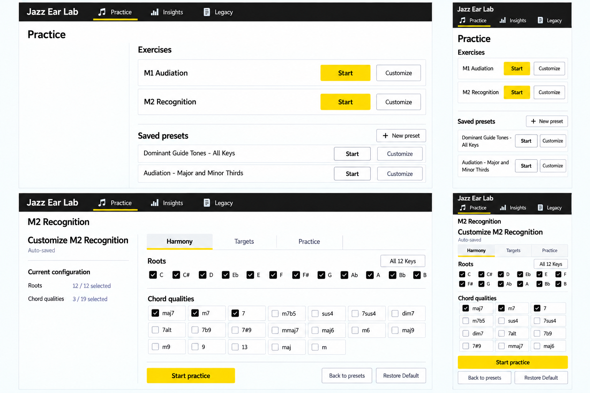
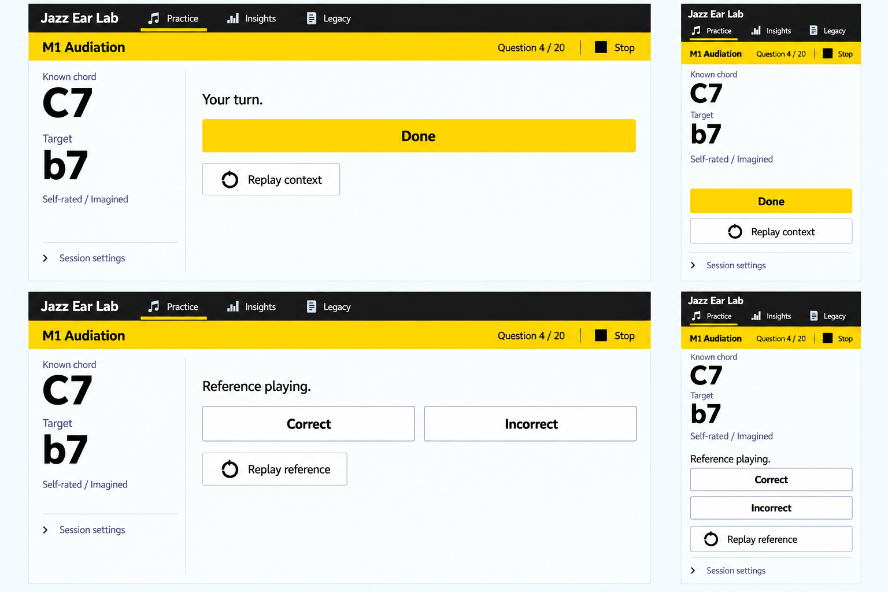
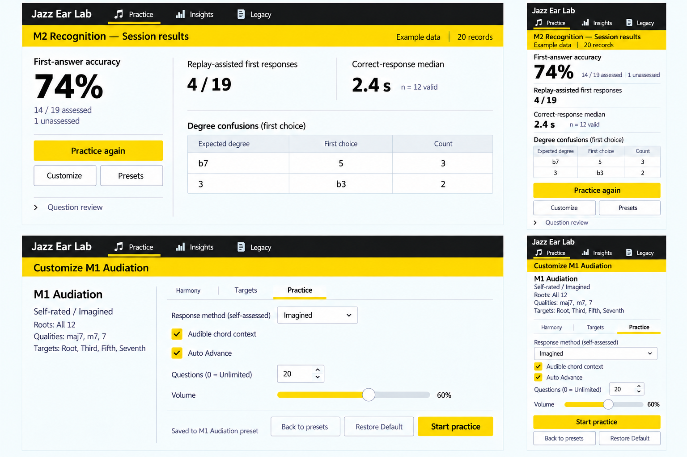

# Split Desk: Remaining V2 Flow Mockups

Status: Flow-extension mockups awaiting user confirmation, 2026-10-24.
The user approved **C - Split Desk** for M2 Practice and Insights, including
extension to the other V2 screens. That approval is recorded in the selected
comp's sidecar and the [selection record](2026-10-24-visual-identity-selection.json).
The new boards below are not yet approved. No application implementation,
metric change, new mode or Legacy change is part of this update.

## Fixed Direction

Signal Route uses black navigation, restrained yellow current-task/action
emphasis, white open workspaces and humanist text. Split Desk places the task
or outcome on the left and working controls/evidence on the right on desktop;
phone views stack the same semantic order. Preserve the already approved
[UX principles](../../UX_PRINCIPLES.md), [Practice plan](../../V2_PRACTICE_UX_REDESIGN_PLAN.md)
and [Insights plan](../../V2_INSIGHTS_UX_REDESIGN_PLAN.md). Brand replacement
approval supersedes only the earlier preserve-old-style limitation for V2.

## 1. Entry and Harmony

- Only M1 Audiation and M2 Recognition are primary entries, with Start and
  Customize. Saved presets remain secondary, including the existing two
  built-in focused presets; their Start controls are deliberately quieter.
- Harmony, Targets and Practice stay independently accessible. Harmony has
  independent root and quality checkbox groups, auto-save and Restore Default.
- The example shows all 12 roots and three selected qualities out of the
  existing 19; it does not restrict the supported pool.
- The mobile snapshot shows only part of the quality list. All remaining
  qualities must remain in ordinary scrollable page flow with reserved footer
  space in implementation, never disappear behind the Start control.

## 2. M1 Audiation States

- Top: before Done, with C7 and requested b7, ready response, Done and context
  replay. A sustaining chord does not delay an already-ready Done action.
- Bottom: Done time is locked and the reference is ready/still sounding;
  Correct and Incorrect are equal-weight self-rating choices, not a verified
  pitch score. Replay is now explicitly the reference.
- Imagined is a read-only method summary, not a new mid-session editor.
- The wrong-degree/Unknown selector appears only after Incorrect and is not
  pictured in this board. Incorrect alone is not a committed grade; automatic
  progression still requires both a grade and natural reference completion.

## 3. Results and Practice Settings

- Results use visibly illustrative M2 data: 20 records, 14/19 assessed correct,
  1 unassessed and rounded accuracy 74%. The five wrong first answers are
  represented as b7 -> 5 three times and 3 -> b3 twice, without a diagnosis.
- Replay assistance is 4/19 assessed; the correct-response median is 2.4 s
  with 12 valid correct timing records. These denominators are intentionally
  distinct. Results retain Practice again, Customize, Presets and review.
- Practice settings show M1's self-assessed method, audible context, Auto
  Advance, count 20 with 0 = Unlimited, volume 60%, saved feedback and existing
  start/restore/navigation actions. The left summary is configuration, not
  historical performance or a new analytics panel.

## State Coverage and Non-Literal Details

These boards complement the already approved [M2/Insights Split Desk board](../mocks/signal-route/03-split-desk.png).
They do not replace the full state-flow specification. Targets selection,
invalid drafts, restore confirmation, M1 wrong-degree selection, graded
reference waits, M2 retries/Reveal, audio recovery, storage errors and manual
Next/Finish retain their approved contracts even where not illustrated.
The Functional / Exact target controls must use the established selection and
labeling rules; no targets disappear because the Harmony screenshot does not
show that separate tab.

Generated glyphs, local heading repetition, sidebar/control rules, compact
phone text, exact target dimensions and incidental nav highlighting are not
new behavioral requirements. In particular, Results must preserve the existing
route/active-navigation semantics unless a change is explicitly approved.
Bar proportions, accessible contrast, keyboard focus, saved-status persistence,
mobile scroll/footers and actual touch dimensions need semantic implementation
and browser/device verification. No code or accessibility certification is
implied by these images.

## Generation and Approval Record

All three boards were produced with the built-in image tool using the approved
C board as a visual reference. One correction batch removed invented internal
homepage navigation, made saved preset starts secondary, removed an editable-
looking M1 method field, corrected Expected degree wording and removed
fabricated performance statistics from the settings page. The final boards
were inspected; exact original and edit prompts remain in adjacent JSON files
and final prompts are embedded in the PNGs. The data are examples, not personal
practice records. No fallback API or API key was used.

The engine's comp gate has passed with three composition options and one
user-approved C. Its scanner requires flat PNGs plus .png.json sidecars, so
byte-identical mirrors of the original composition boards live directly under
.impeccable/mocks/; the nested user-facing links remain unchanged. Workflow
state is at spec, with measurement/application implementation deliberately
not started while this flow confirmation is pending. The six-block direction
contract is recorded in the V2 development-only surface brief; it must not be
embedded in application source, runtime UI or production bundles.

Next: confirm these extensions as the implementation reference, or request a
specific correction. Confirmation must not silently change any exercise,
scoring, timing, storage or analytical semantics.
