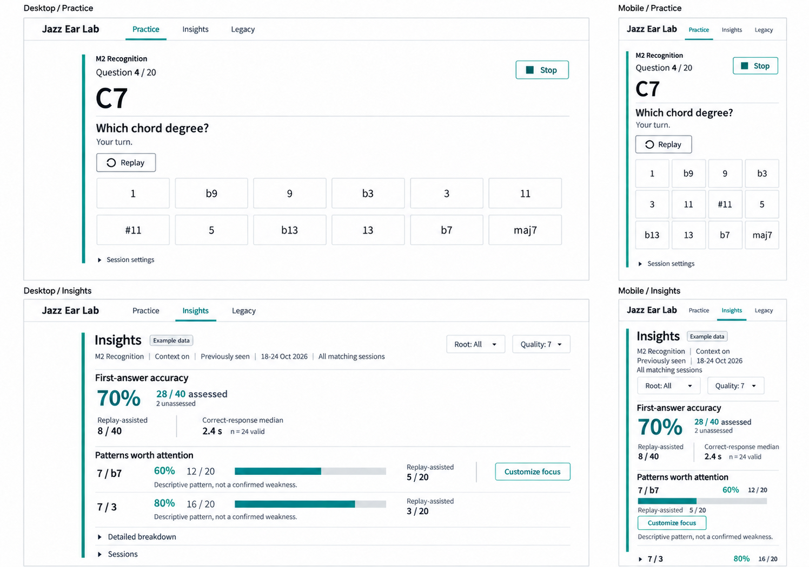
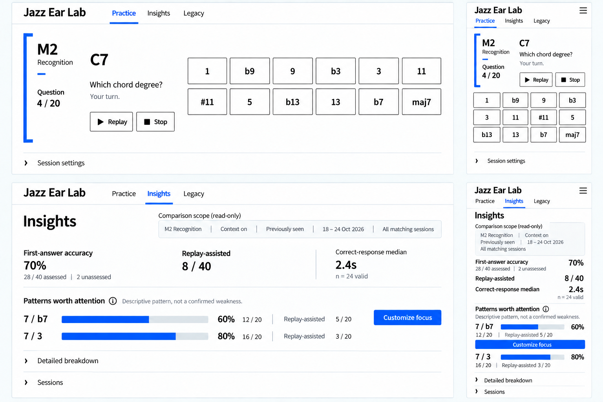
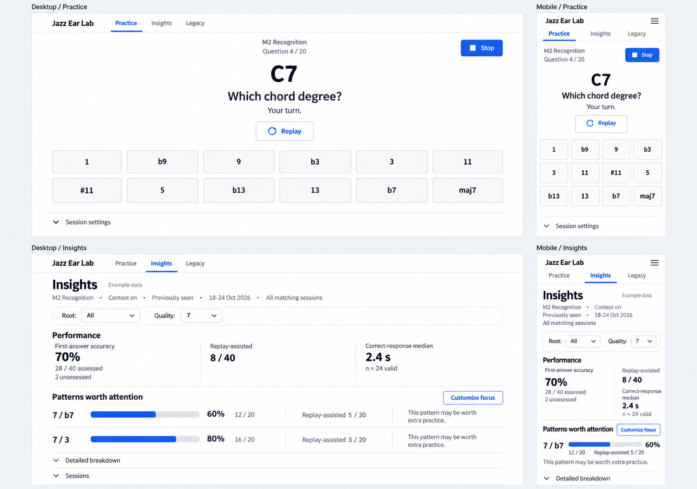

# Ear Train Visual Identity Comparison

User-selected direction: **Signal Route**, 2026-10-24. Scope: the complete V2 flow, keeping Legacy unchanged and Ear Train / Jazz Ear Lab naming. Comp-led workflow retained. No application implementation or final composition approval is included in this selection.

All boards use illustrative data, not the user's history. They compare the same M2 Recognition question and Insights evidence across desktop and mobile. Generated text and pixel geometry are not a replacement for the approved UX and analytics contracts. The detailed review notes identify remaining render deviations.

## Direction Tradeoffs

| Direction | Visual language | Strength | Tradeoff |
| --- | --- | --- | --- |
| Phrase Desk | White/ink workspace, sea-glass working rail, humanist type, quiet degree keys. | Calm repeated practice and evidence-linked actions. | More specialist-editor character; understated rather than highly distinctive. |
| Ensemble Score | Cobalt structural bracket, strong sans hierarchy, measured answer rows. | A strong musical/task anchor with clear spatial organization. | The bracket consumes space; generated content omissions must not become functionality decisions. |
| Signal Route - selected | Black navigation, yellow task/direction bands, humanist labels, white answer/evidence surfaces. | Fast orientation and unmistakable next actions on both device sizes. | Yellow and bold type must be restrained to avoid fatigue and excess visual urgency. |
| Familiar Workspace | Conventional white/gray/blue controls and centered practice layout. | Familiarity and low visual learning cost. | Deliberately less ownable; not the recommended identity and not the user's selection. |

## Phrase Desk

## Ensemble Score

## Signal Route - Selected

## Familiar Workspace

## Next Approval Boundary

Use the selected decision board as composition option one. Develop two variations within Signal Route and compare before implementation; do not silently redesign it from scratch. Then extend the approved composition to the other V2 screens. Keep the task anchor, explicit labels, canonical answer order, independent pools, first-evidence semantics, accuracy-first Insights hierarchy and all recovery/transition rules.

For this direction, yellow signals location/action, not correctness; no invented airport/travel feature, new mode, swipe progression or hidden-label interaction is approved. Exact control sizes, focus, responsive layout, evidence labels and numerical chart lengths require semantic implementation and verification later. The generated board does not certify accessibility or actual app behavior.

Supporting records: [Exploration and review](2026-10-24-visual-identity.md), [decision payload](2026-10-24-visual-identity.json), [user selection](2026-10-24-visual-identity-selection.json). Prompt sidecars beside every board record the built-in image-generation/editing prompts and unapproved composition status. Original approval-server runtime files are local-only.
