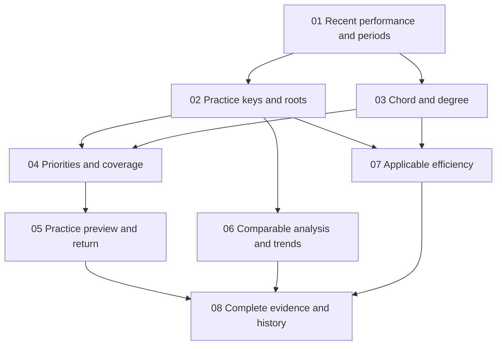

# Actionable V2 Insights — proposed ticket breakdown

Status: user-approved breakdown; tickets initially published ready-for-agent and now completed.
See [current delivery status](README.md) and the linked implementation report.
Date: 2026-10-29, Asia/Hong_Kong.

Source: [ready local specification](../../V2_ACTIONABLE_INSIGHTS_SPEC.md).
Design: [information architecture](../../V2_INSIGHTS_INFORMATION_DESIGN.md).
The user confirmed the browser-first test seam. The specification, including its
first-version defaults and 17 acceptance examples, remains the contract.

## Approved vertical slices

### 01 — Recent-performance overview and period scope

**Blocked by:** None (can start immediately).

**What it delivers:** Open Insights, select Overall or one of the three families
and two contexts, select 7/28/90 days or All, and see the correct recent results,
assessment provenance and sample counts without scrolling past seven mode buttons.

**Acceptance outline:**

- Overall has three family sections with two distinct contexts each; mode detail
  has one primary correct/assessed result, question/session counts and unassessed
  outcomes. Existing combined degree accuracy remains secondary and denominator-weighted.
- Implement the smallest shared evidence normalization/date attribution prefactor
  first within this slice and immediately exercise it through rendered summaries.
  Read actual note/question/session identities and structured snapshots; preserve
  unknown tags, raw histories, old played Audiation and all existing exercise IDs.
- Apply the exact local-calendar period and fallback-date rules, including DST,
  unknown-date All evidence and finite-period empty states. Label this-browser scope.
- A storage read failure is recoverable and never fabricated as empty history.
- Reuse existing visual identity, mobile semantic order and keyboard controls.
  Existing direct session links remain functional during incremental delivery.

**Primary user stories:** 1–15, 65–66, 70–76.
**Primary acceptance examples:** 3–4, 13, 15, 17; this slice's portion of 16.

### 02 — Actual practice-key and single-chord root analysis

**Blocked by:** 01 — Recent-performance overview and period scope.

**What it delivers:** In any progression mode, inspect the twelve actual practice
keys and select one to see scoped results. In Single Chord, inspect roots with an
explicit explanation that they are not inferred tonal keys.

**Acceptance outline:**

- Attribute a random-key question only to its actual draw, not its configured pool.
  Keep C-source, sounding key and note chord root distinct.
- Show correct/assessed, distinct question count, sessions/evidence status and
  explicit no-record/unknown/unassessed/insufficient states; never show 0/0 as 0%.
- Preserve musical ordering, compatible period/family/context filters, removable
  selections and clear controls. Mixed-condition key summaries are descriptive,
  not weak-key rankings. The later comparable-analysis slice owns controlled mode.
- Safely normalize supported root spellings while retaining original display labels;
  never infer a missing tonic, practice key or C-source for older records.
- Own all three progression families and the three Single Chord variants, not
  merely the Play by Ear route.

**Primary user stories:** 32–38, 49–50, 66–67.
**Primary acceptance examples:** 1–2, key-related portions of 8/13/17; slice portion of 16.

### 03 — Chord and degree drill-down with contextual confusions

**Blocked by:** 01 — Recent-performance overview and period scope.

**What it delivers:** Explore chord quality, full chord and degree, keep scope
visible, and understand recorded directed mistakes without a long list of generic
settings buttons or an initial giant cross-tabulation.

**Acceptance outline:**

- Support quality/full-chord views and root filtering; initial chord list is capped
  at five rows with All and specified descriptive sort/tie-break options.
- Drill into a chord's degrees and recorded progression occurrences/context. Degree
  defaults to quality × degree; all-chord degree summaries are explicitly mixed.
- Retain applicable active selections while changing dimension. Consume the shared
  analysis-selection state; after 02 is present, key selection carries through
  automatically rather than requiring a separate chord/degree screen implementation.
- Confusions use first wrong answers or self-rated wrong-degree annotations with
  provenance. Explicit Unknown, absent annotation and unassessed remain distinct.
- Keep first outcomes immutable across retries/review and deduplicate musical groups.
  Unsupported labels/source functions remain unknown rather than guessed.

**Primary user stories:** 39–50, 64, 67.
**Primary acceptance examples:** chord/degree portion of 8, 14; slice portion of 16.

### 04 — Evidence-based priorities and coverage gaps

**Blocked by:** 02 — Practice-key/root analysis; 03 — Chord/degree drill-down.

**What it delivers:** A selected mode shows at most three intelligible next-practice
observations, with the underlying evidence accessible. Recurrent errors and gaps in
coverage are visibly different, and insufficient evidence produces an honest state.

**Acceptance outline:**

- Enforce candidate minima of 20 assessed notes, 10 questions, 3 sessions and 3
  errors spread over 2 sessions. Do not count a long phrase as many questions.
- Apply compatible-stratum scope, specified ordering and most-recent eligible
  stratum selection without globally ranking unrelated difficulty contexts.
- Merge ancestor/descendant observations concerning the same error IDs; prefer the
  most specific actionable context. No three cards for the same errors.
- Coverage uses an explicit compatible setup snapshot and its candidate domain;
  excluded keys are not neglected keys. Display the chosen baseline and allow
  selection when multiple setups exist. Missing baseline does not invent a pool.
- View evidence opens matching musical filters/counts; Overall routes into a context
  instead of ranking six skills against each other. The next slice adds setup handoff.
- Low mixed-condition percentages stay descriptive and do not become diagnoses.

**Primary user stories:** 16–24.
**Primary acceptance examples:** 4–6; slice portion of 16.

### 05 — Faithful practice-configuration preview and return

**Blocked by:** 04 — Evidence-based priorities and coverage gaps.

**What it delivers:** Select a priority, preview practice that carries its actual
musical context, then return to the same Insights investigation without starting
playback or changing the source preset unexpectedly.

**Acceptance outline:**

- Add a single primary setup action alongside evidence. Validate a structured
  source context, retain the exercise identity and show every narrowed condition.
- Use an independent draft so autosave never overwrites the source. Fixed-key
  narrowing from random practice is explicit; original key pool remains unchanged.
- Retain a complete C-source progression, durations and compatible BPM/pools/mix.
  Never collapse a progression suggestion into Single Chord practice.
- Disclose quality-wide targeting or a supported broader scope when occurrence-
  specific settings do not exist. Do not claim a new targeting capability.
- Without trustworthy source settings, keep evidence available and omit a misleading
  setup action. Return restores period, context, dimension and active filters.
- Include draft-save/start/back/cancel behaviour and storage failures within this
  slice; do not postpone preset protection to final integration.

**Primary user stories:** 25–31.
**Primary acceptance examples:** 7 and configuration-return portion of 8; slice portion of 16.

### 06 — Comparable-condition key analysis and period trends

**Blocked by:** 02 — Practice-key/root analysis.

**What it delivers:** Select comparable-condition key analysis or inspect the mode's
previous-period change, see its exact scope and sample coverage, and avoid being told
that an easier practice mix is evidence of improvement.

**Acceptance outline:**

- Expose a controlled key view retaining source progression, key policy/pool,
  rhythm, targets, accompaniment, versions and other specified compatible context;
  drawn key/actual transposed chords remain the analytical variable.
- Apply all finite-period, eligibility, unknown-critical-context and exposure/date-
  provenance rules; All has no automatic previous-period delta.
- For matched strata, use pooled assessed-count weights identically in both periods,
  show both denominators and matched coverage, and report percentage-point observations.
- Keep the all-matching current result distinct from the matched comparison subset.
  No eligible subset is unavailable comparison, not zero change or a direction arrow.
- New generator versions, differing BPM/pools/methods and practice-composition shifts
  cannot manufacture a learning claim. Offer underlying compatible conditions in
  readable musical language with technical detail disclosed.
- Integrate with the mode overview from 01 and key view from 02. Chord/degree view
  construction is not a prerequisite; reuse shared compatible-scope contracts.

**Primary user stories:** 52–56 and controlled comparison portion of 38.
**Primary acceptance examples:** 9–11; slice portion of 16.

### 07 — Grain-correct completion efficiency and assistance

**Blocked by:** 02 — Practice-key/root analysis; 03 — Chord/degree drill-down.

**What it delivers:** Each mode shows only applicable response efficiency. Play by
Ear key/chord investigations show whole-question delay in an explicit question scope,
never a fictional per-degree or per-chord playing speed.

**Acceptance outline:**

- Retain existing Single Chord Recognition and Audiation boundaries/eligibility,
  method distinction and valid medians; do not add timing to non-timed progression
  Recognition/Audiation. No mixed all-mode speed statistic.
- Play by Ear contributes one finite non-negative delay per eligible submitted,
  all-first-correct, uninterrupted, no-pre-Done-replay question. Retain valid zero.
- Key filters select actual whole questions. Chord/root scopes may mean questions
  containing that chord, explicitly labelled; degree selection has no per-degree
  delay and cannot silently masquerade as the time scope.
- Display eligible n and compact exclusion information with inspectable reasons;
  retain compatible timing/difficulty strata rather than inventing an aggregate.
- Descriptive accuracy retains assessed assisted outcomes with their share; event
  counts remain question-grain. Existing audio, first Done and grade locks remain.
- These are separate applicable summaries using existing public timing/model seams;
  06 is not a blocker because no weighted trend is needed to deliver valid medians.

**Primary user stories:** 57–65.
**Primary acceptance examples:** 12, timing/assistance portion of 14; slice portion of 16.

### 08 — Complete evidence explorer and faithful history journeys

**Blocked by:** 05 — Configuration preview; 06 — Comparable trends; 07 — Efficiency.

**What it delivers:** From the summarized result or a practice priority, inspect full
filtered tables, cross-tabs, conditions and matching sessions, reload a saved result,
and return with the same analysis context and unmodified historical evidence.

**Acceptance outline:**

- Deliver the expanded full key×chord / chord×degree evidence, directed confusions,
  readable conditions and separately disclosed technical provenance. Keep the main
  workspace bounded even with hundreds of strata.
- Matching session lists obey the selected analysis evidence, include stable result
  links and support matching-history reload/return. A date-filtered subset does not
  relabel whole-session counts as if they were subset counts.
- Preserve old unknown key/date/C-source/version states and old played Audiation;
  show recoverable read/empty states without migration or fabricated evidence.
- Verify complete six-mode overview → drill-down → priority → config → return and
  evidence → session → reload paths. This slice provides the complete evidence UI,
  not a substitute for each earlier slice's own functional/recovery tests.
- Verify desktop/mobile 1440/390/320, native controls, keyboard/focus, text labels,
  local table scrolling and preserved histories/presets/Legacy across the delivered
  surface. Keep counts and result/timing grain consistent after every navigation.

**Primary user stories:** 51, 68–76; integrated 24/31/49/65–66.
**Primary acceptance examples:** integrated 8, 15–17.

## Blocking graph and frontier

Initial frontier: 01 only. After 01: 02 and 03. After 02: 06 may start; 04/07
need both 02 and 03. 05 follows 04; 08 follows 05/06/07.
These edges describe prerequisites, not authorization to spawn agents.
03 and 02 share integration contracts, but shared-file edits alone are not a reason
for a false blocker. 06 does not depend on recommendation generation, and 07 does
not depend on weighted trends. 08 has no redundant transitive edges to 01–04.

## Complete specification coverage

All 76 user stories are assigned by the primary ranges above; cross-cutting stories
may appear in multiple slices because each slice must own its user-facing correctness.
All 17 acceptance examples have an owning slice:

| Example | Owner | Supporting / integration |
|---|---|---|
| 1 Actual key and chord root | 02 | 01, 03 |
| 2 Single Chord without tonic | 02 | 01 |
| 3 Weighted Overall accuracy | 01 | 08 |
| 4 Sparse/unassessed | 01 | 04 |
| 5 Priority eligibility | 04 | — |
| 6 Priority merging/coverage | 04 | 02, 03 |
| 7 Practice preview | 05 | 04 |
| 8 Filters/config/history return | 08 | 02, 03, 05 |
| 9 Composition-shift protection | 06 | — |
| 10 Real matched difference | 06 | — |
| 11 Incompatible settings/versions | 06 | 01 |
| 12 Timing grain and zero | 07 | 02, 03 |
| 13 Dates/missing context | 01 | 02 |
| 14 First evidence/annotation | 03 | 07 |
| 15 Read failure/empty period | 01 | 08 |
| 16 Bounded responsive interface | Every slice | 08 full journey |
| 17 Old history/identity | 01 | 08 full evidence |

## Shared delivery rules and sizing

- Each slice includes only its necessary shared prefactoring, normalization,
  presentation and public-interface/browser verification. No unused analytics
  framework, new parallel store, schema-only prerequisite or broad mechanical
  refactor is justified by current code.
- Keep each ticket within one fresh implementation context. If a future discovery
  changes that, revise the concrete slice before starting, rather than implementing
  a half-delivered horizontal layer and calling it done.
- All slices preserve audio, sampling, first evidence, Legacy, source presets and
  stored history. Follow the user-confirmed browser-first testing seam, with public
  model/progression checks for genuinely unobservable calculations.
- Existing tests that encode the old seven-button UI should be adapted to the new
  family/context navigation while retaining behavioural coverage; do not discard
  assertions merely to make the redesign pass.
- Spec and design documents remain unchanged. Publication creates no runtime
  changes, GitHub issues, external labels or parent closure.

## Approval / publication

The user confirmed this breakdown without merges, splits or edge changes. Eight
separate local issue files are now published, numbered 01–08, with ready-for-agent
status, explicit blockers, acceptance checkboxes and specification coverage. See
[the ticket index](README.md). A blocked ready-for-agent ticket is not startable
until its blockers finish. This confirmation did not start implementation.

Global issue-tracker/triage setup remains absent. Continue the established feature-
local pattern only; external tracker publication requires `/setup-matt-pocock-skills`
configuration/access. No global tracker choice is made by this proposal.
